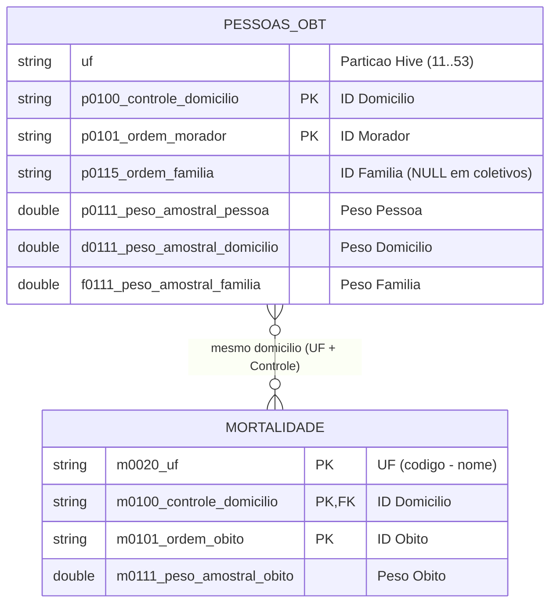

# Dicionário de Dados e Modelagem — Censo Demográfico 2022 (Dataset Curado)

> **Problema de pesquisa:** *"Quais características demográficas e domiciliares estão associadas às diferentes condições de vida da população brasileira?"*  
> **Créditos:** Pipeline e documentação elaborados com auxílio do **Google Antigravity**.  
> **Base de origem:** Microdados da Amostra do Censo Demográfico 2022 — **Acesso Controlado (Nível 2)** ([`microdados_censo_amostra_2022_csv_20261124_094334.zip`](../microdados_censo_amostra_2022_csv_20261124_094334.zip)).  
> **Referência oficial 100% vinculada a:**
> - [`Layout_Microdados_CD2022_Controlado.xlsx`](Layout_e_dicionario/Layout_Microdados_CD2022_Controlado.xlsx)
> - [`Dicionario_de_Variaveis_Microdados_CD2022.pdf`](Layout_e_dicionario/Dicionario_de_Variaveis_Microdados_CD2022.pdf)
> - [`Municipios_BR_Recortes_Territoriais_2022.xlsx`](Divisao_territorial/Municipios_BR_Recortes_Territoriais_2022.xlsx)
> - Bancos de Descritores em [`docs/Bancos_de_descritores/`](Bancos_de_descritores/)
> - Notas Metodológicas em [`docs/Notas_metodologicas/`](Notas_metodologicas/)

---

## 1. Arquitetura, Grão e Chaves das Tabelas

O dataset curado foi modelado em **duas tabelas em formato Parquet (compressão ZSTD)** para equilibrar facilidade analítica, integridade estatística e alta performance:

### Tabela 1 — `data/curated/pessoas_obt/` (One Big Table particionada por `uf=11`..`uf=53`)
* **Grão:** **1 linha = 1 pessoa** recenseada na amostra do Censo 2022 (21,539,579 linhas no Brasil inteiro).
* **Construção relacional:** `Pessoas` (`PESS`) `LEFT JOIN` `Domicilios` (`DOMI`) por `(UF, Controle)` + `LEFT JOIN` `Familia` (`FAMI`) por `(UF, Controle, Ordem da Família)`.
* **Chave Primária (única verificada = `True`):** `(uf, p0100_controle_domicilio, p0101_ordem_morador)`
* **Chave de Domicílio:** `(uf, p0100_controle_domicilio)` — 7,689,963 domicílios únicos na amostra.
* **Chave de Família:** `(uf, p0100_controle_domicilio, p0115_ordem_familia)` — 6,550,293 famílias únicas na amostra (`p0115_ordem_familia` é `NULL` para moradores de domicílios coletivos).
* **Coluna de partição Hive:** `uf` (`'11'` a `'53'`), criada automaticamente pela estrutura de pastas `uf=XX/part.parquet`, além da coluna descritiva `p0020_uf` (`'11 - Rondônia'`, ..., `'53 - Distrito Federal'`).
* **Total de colunas:** **172 colunas** (além da coluna virtual de partição `uf`).

### Tabela 2 — `data/curated/mortalidade/mortalidade.parquet` (Separada, sem agregação)
* **Grão:** **1 linha = 1 óbito** de morador ocorrido no domicílio entre janeiro/2019 e julho/2022 (430,965 linhas no Brasil inteiro).
* **Por que separada?** Um mesmo domicílio pode ter registrado `0, 1, 2 ou mais` óbitos. Juntá-la diretamente à OBT de pessoas causaria produto cartesiano e distorceria contagens e pesos amostrais.
* **Chave Primária (única verificada = `True`):** `(m0020_uf, m0100_controle_domicilio, m0101_ordem_obito)`
* **Chave para cruzamento com Domicílios:** `(SUBSTRING(m0020_uf, 1, 2), m0100_controle_domicilio)` ↔ `(uf, p0100_controle_domicilio)`.
* **Total de colunas:** **20 colunas**.



---

## 2. Regras Metodológicas Obrigatórias (Pesos Amostrais e Deduplicação)

> ⚠️ **Regra de ouro do Censo 2022 (Amostra):** Nunca calcule proporções ou totais populacionais usando `COUNT(*)` simples sem ponderação. Utilize sempre o **peso amostral correspondente à unidade de análise**, conforme a Nota Metodológica [`NM_04_2026_Expansao_Amostra.pdf`](Notas_metodologicas/NM_04_2026_Expansao_Amostra.pdf).

| Unidade de Análise | Tabela | Deduplicação Necessária? | Peso Amostral | Total Expandido Validado (BR) |
| :--- | :--- | :--- | :--- | ---: |
| **Pessoas** (incluindo pessoas por condição do domicílio/família) | `pessoas_obt` | **Não** (já está no grão pessoa) | `p0111_peso_amostral_pessoa` | **203,080,756** |
| **Domicílios** | `pessoas_obt` | **Sim:** 1 linha por `(uf, p0100_controle_domicilio)` | `d0111_peso_amostral_domicilio` | **73,313,618** |
| **Famílias** | `pessoas_obt` | **Sim:** filtrar `p0115_ordem_familia IS NOT NULL` e deduplicar por `(uf, p0100_controle_domicilio, p0115_ordem_familia)` | `f0111_peso_amostral_familia` | **62,037,364** |
| **Óbitos** | `mortalidade` | **Não** (já está no grão óbito) | `m0111_peso_amostral_obito` | **4,026,946** |

### Exemplo prático em DuckDB SQL (Deduplicação para Domicílios)
```sql
-- Exemplo: % de DOMICÍLIOS brasileiros por tipo de esgotamento sanitário
WITH domicilios_unicos AS (
    SELECT
        uf,
        p0100_controle_domicilio,
        ANY_VALUE(d0111_peso_amostral_domicilio) AS peso_dom,
        ANY_VALUE(d0250_tipo_esgotamento_sanitario_domicilio) AS esgoto
    FROM read_parquet('data/curated/pessoas_obt/uf=*/part.parquet', hive_partitioning=true)
    GROUP BY uf, p0100_controle_domicilio
)
SELECT
    esgoto,
    ROUND(SUM(peso_dom), 0) AS domicilios_estimados,
    ROUND(100.0 * SUM(peso_dom) / SUM(SUM(peso_dom)) OVER (), 2) AS pct
FROM domicilios_unicos
GROUP BY esgoto
ORDER BY domicilios_estimados DESC;
```

---

## 3. Convenções de Formatação

1. **Nomenclatura das colunas:** `<codigo_ibge_minusculo>_<nome_legivel>` (ex.: `p0160_sexo`, `d0360_rendimento_domiciliar_per_capita`). Permite rastrear imediatamente qualquer coluna até o PDF/Excel oficial do IBGE.
2. **Decodificação em coluna única (`"código - descrição"`):** Todas as variáveis categóricas (internas do Layout e externas dos Bancos de Descritores) foram decodificadas diretamente para o formato `"código - descrição"` (ex.: `"1 - Masculino"`, `"3550308 - São Paulo (SP)"`).
3. **Valores ausentes / não aplicáveis:** Campos em branco nos CSVs originais foram convertidos para `NULL` nativo do Parquet.
4. **Variáveis numéricas e chaves:** Pesos amostrais, rendimentos, idades numéricas, contagens de moradores/cômodos/filhos foram convertidos para `BIGINT` ou `DOUBLE` puros; chaves (`p0100_controle_domicilio`, `p0101_ordem_morador`, `p0115_ordem_familia`, `m0100_controle_domicilio`, `m0101_ordem_obito`) permanecem como `VARCHAR` sem decodificação.

---

## 4. Catálogo Completo de Variáveis — `pessoas_obt` (172 colunas)

| # | Coluna Curada (Parquet) | Código IBGE | Origem | Tipo Parquet | Papel | Descrição Oficial (Layout IBGE) |
| :---: | :--- | :---: | :---: | :---: | :--- | :--- |
| 1 | `p0010_grande_regiao` | `P0010` | `PESS` | `VARCHAR` | Categórica (5 cats.) | Grande Região |
| 2 | `p0020_uf` | `P0020` | `PESS` | `VARCHAR` | Descritor externo (uf) | Unidade da Federação |
| 3 | `p0030_mesorregiao` | `P0030` | `PESS` | `VARCHAR` | Descritor externo (mesorregiao) | Mesorregião |
| 4 | `p0040_microrregiao` | `P0040` | `PESS` | `VARCHAR` | Descritor externo (microrregiao) | Microrregião |
| 5 | `p0050_regiao_intermediaria` | `P0050` | `PESS` | `VARCHAR` | Descritor externo (rgint) | Região Geográfica Intermediária |
| 6 | `p0060_regiao_imediata` | `P0060` | `PESS` | `VARCHAR` | Descritor externo (rgi) | Região Geográfica Imediata |
| 7 | `p0070_concentracao_urbana` | `P0070` | `PESS` | `VARCHAR` | Descritor externo (concentracao_urbana) | Concentração urbana |
| 8 | `p0080_municipio` | `P0080` | `PESS` | `VARCHAR` | Descritor externo (municipio) | Município |
| 9 | `p0090_area_ponderacao` | `P0090` | `PESS` | `VARCHAR` | Código bruto | Área de Ponderação |
| 10 | `p0100_controle_domicilio` | `P0100` | `PESS` | `VARCHAR` | Chave | Controle |
| 11 | `p0101_ordem_morador` | `P0101` | `PESS` | `VARCHAR` | Chave | Número de ordem do morador |
| 12 | `p0111_peso_amostral_pessoa` | `P0111` | `PESS` | `DOUBLE` | Peso amostral | Peso Amostral (Versão acesso Controlado) |
| 13 | `p0115_ordem_familia` | `P0115` | `PESS` | `VARCHAR` | Chave | Número de ordem da Família |
| 14 | `p0120_situacao_setor` | `P0120` | `PESS` | `VARCHAR` | Categórica (7 cats.) | Situação do Setor |
| 15 | `p0130_especie_unidade_visitada` | `P0130` | `PESS` | `VARCHAR` | Categórica (3 cats.) | Espécie da unidade visitada |
| 16 | `p0140_situacao_domicilio` | `P0140` | `PESS` | `VARCHAR` | Categórica (2 cats.) | Situação do domicílio |
| 17 | `p0150_sexo_imputado_publico` | `P0150` | `PESS` | `VARCHAR` | Categórica (3 cats.) | Sexo |
| 18 | `p0160_sexo` | `P0160` | `PESS` | `VARCHAR` | Categórica (2 cats.) | Sexo |
| 19 | `p0170_condicao_domicilio_pessoa` | `P0170` | `PESS` | `VARCHAR` | Categórica (20 cats.) | Condição no domicílio da pessoa, categoria |
| 20 | `p0180_idade_faixa` | `P0180` | `PESS` | `VARCHAR` | Categórica (18 cats.) | Idade calculada em anos da pessoa, categoria |
| 21 | `p0181_idade_anos` | `P0181` | `PESS` | `BIGINT` | Numérica (inteiro) | Idade calculada em anos da pessoa, número |
| 22 | `p0190_idade_meses` | `P0190` | `PESS` | `BIGINT` | Numérica (inteiro) | Idade calculada em meses da pessoa, número |
| 23 | `p0200_forma_declaracao_idade` | `P0200` | `PESS` | `VARCHAR` | Categórica (2 cats.) | Forma de declaração de idade |
| 24 | `p0210_cor_raca_pessoa` | `P0210` | `PESS` | `VARCHAR` | Categórica (6 cats.) | Cor ou raça da pessoa, categoria |
| 25 | `p0220_pessoa_indigena` | `P0220` | `PESS` | `VARCHAR` | Categórica (3 cats.) | Pessoa Indígena, categoria |
| 26 | `p0230_uso_lingua_portuguesa_domicilio_pessoa` | `P0230` | `PESS` | `VARCHAR` | Categórica (3 cats.) | Uso da língua portuguesa no domicílio da pessoa, categoria. |
| 27 | `p0240_status_declaracao_etnia` | `P0240` | `PESS` | `VARCHAR` | Categórica (6 cats.) | Status de declaração de etnia |
| 28 | `p0250_status_declaracao_lingua_indigena` | `P0250` | `PESS` | `VARCHAR` | Categórica (7 cats.) | Status de declaração de língua indígena |
| 29 | `p0260_pessoa_quilombola` | `P0260` | `PESS` | `VARCHAR` | Categórica (2 cats.) | Pessoa quilombola, categoria |
| 30 | `p0270_existencia_tipo_registro_nascimento_pessoa` | `P0270` | `PESS` | `VARCHAR` | Categórica (5 cats.) | Existência e tipo de registro de nascimento da pessoa, categoria |
| 31 | `p0280_convivencia_conjuge_companheiro_pessoa` | `P0280` | `PESS` | `VARCHAR` | Categórica (3 cats.) | Convivência com cônjuge ou companheiro da pessoa, categoria |
| 32 | `p0290_natureza_uniao` | `P0290` | `PESS` | `VARCHAR` | Categórica (4 cats.) | Natureza da união, categoria |
| 33 | `p0300_moradia_mae_madrasta_domicilio_pessoa` | `P0300` | `PESS` | `VARCHAR` | Categórica (2 cats.) | Moradia da mãe ou madrasta no domicílio da pessoa, categoria |
| 34 | `p0310_moradia_pai_padrasto_domicilio_pessoa` | `P0310` | `PESS` | `VARCHAR` | Categórica (2 cats.) | Moradia do pai ou padrasto no domicílio da pessoa, categoria |
| 35 | `p0320_filhos_homens_nascidos_vivos_pessoa` | `P0320` | `PESS` | `BIGINT` | Numérica (inteiro) | Filhos homens nascidos vivos da pessoa, número |
| 36 | `p0330_filhas_mulheres_nascidas_vivas_pessoa` | `P0330` | `PESS` | `BIGINT` | Numérica (inteiro) | Filhas mulheres nascidas vivas da pessoa, número |
| 37 | `p0340_filhos_nascidos_vivos_pessoa` | `P0340` | `PESS` | `BIGINT` | Numérica (inteiro) | Filhos nascidos vivos da pessoa, número |
| 38 | `p0350_filhos_homens_vivos_pessoa` | `P0350` | `PESS` | `BIGINT` | Numérica (inteiro) | Filhos homens vivos da pessoa, número |
| 39 | `p0360_filhas_mulheres_vivas_pessoa` | `P0360` | `PESS` | `BIGINT` | Numérica (inteiro) | Filhas mulheres vivas da pessoa, número |
| 40 | `p0370_filhos_vivos_pessoa` | `P0370` | `PESS` | `BIGINT` | Numérica (inteiro) | Filhos vivos da pessoa, número |
| 41 | `p0380_idade_ultimo_filho_faixa` | `P0380` | `PESS` | `VARCHAR` | Categórica (18 cats.) | Idade calculada do último filho nascido vivo da pessoa, categoria |
| 42 | `p0381_idade_ultimo_filho_anos` | `P0381` | `PESS` | `BIGINT` | Numérica (inteiro) | Idade calculada do último filho nascido vivo da pessoa, número |
| 43 | `p0390_forma_declaracao_idade_ultimo_filho_tido_nascido` | `P0390` | `PESS` | `VARCHAR` | Categórica (2 cats.) | Forma de declaração de idade do último filho tido nascido vivo |
| 44 | `p0400_existencia_filho_nascido_vivo_periodo_12_meses` | `P0400` | `PESS` | `VARCHAR` | Categórica (2 cats.) | Existência de filho nascido vivo no período de 12 meses, categoria |
| 45 | `p0410_religiao_grande_grupo` | `P0410` | `PESS` | `VARCHAR` | Descritor externo (religiao_p0410) | Religião ou culto, categoria |
| 46 | `p0411_religiao_detalhada` | `P0411` | `PESS` | `VARCHAR` | Descritor externo (religiao_p0411) | Religião ou culto, categoria |
| 47 | `p0420_existencia_deficiencia_visual_pessoa` | `P0420` | `PESS` | `VARCHAR` | Categórica (5 cats.) | Existência de deficiência visual da pessoa, categoria |
| 48 | `p0430_existencia_deficiencia_auditiva_pessoa` | `P0430` | `PESS` | `VARCHAR` | Categórica (5 cats.) | Existência de deficiência auditiva da pessoa, categoria |
| 49 | `p0440_existencia_deficiencia_motora_pessoa` | `P0440` | `PESS` | `VARCHAR` | Categórica (5 cats.) | Existência de deficiência motora da pessoa, categoria |
| 50 | `p0450_existencia_dificuldade_pegar_objetos_pessoa` | `P0450` | `PESS` | `VARCHAR` | Categórica (5 cats.) | Existência de dificuldade em pegar objetos da pessoa, categoria |
| 51 | `p0460_existencia_deficiencia_mental_intelectual_pessoa` | `P0460` | `PESS` | `VARCHAR` | Categórica (5 cats.) | Existência de deficiência mental ou intelectual da pessoa, categoria |
| 52 | `p0470_variavel_indicadora_existencia_deficiencia` | `P0470` | `PESS` | `VARCHAR` | Categórica (3 cats.) | Variável indicadora da Existência de Deficiência |
| 53 | `p0480_local_nascimento_pessoa` | `P0480` | `PESS` | `VARCHAR` | Categórica (4 cats.) | Local de nascimento da pessoa, categoria |
| 54 | `p0490_unidade_federacao_nascimento_pessoa` | `P0490` | `PESS` | `VARCHAR` | Descritor externo (uf) | Unidade da Federação de nascimento da pessoa, código |
| 55 | `p0500_municipio_nascimento_pessoa` | `P0500` | `PESS` | `VARCHAR` | Descritor externo (municipio) | Município de nascimento da pessoa, código |
| 56 | `p0510_pais_nascimento_pessoa` | `P0510` | `PESS` | `VARCHAR` | Descritor externo (pais) | País de nascimento da pessoa, código |
| 57 | `p0520_nacionalidade_pessoa` | `P0520` | `PESS` | `VARCHAR` | Categórica (3 cats.) | Nacionalidade da pessoa, categoria |
| 58 | `p0530_moradia_outro_municipio_pais_estrangeiro_pessoa` | `P0530` | `PESS` | `VARCHAR` | Categórica (3 cats.) | Moradia em outro município ou país estrangeiro da pessoa, categoria |
| 59 | `p0540_ano_fixacao_residencia_pessoa` | `P0540` | `PESS` | `BIGINT` | Numérica (inteiro) | Ano de fixação de residência da pessoa, número |
| 60 | `p0550_tempo_moradia_municipio_pessoa` | `P0550` | `PESS` | `BIGINT` | Numérica (inteiro) | Tempo de moradia no município da pessoa, número |
| 61 | `p0560_unidade_federacao_municipio_pais_estrangeiro_moradia_anterior` | `P0560` | `PESS` | `VARCHAR` | Categórica (3 cats.) | Unidade da Federação e município ou país estrangeiro de moradia anterior da pessoa, categoria |
| 62 | `p0570_unidade_federacao_moradia_anterior_pessoa` | `P0570` | `PESS` | `VARCHAR` | Descritor externo (uf) | Unidade da Federação de moradia anterior da pessoa, código |
| 63 | `p0580_municipio_moradia_anterior_pessoa` | `P0580` | `PESS` | `VARCHAR` | Descritor externo (municipio) | Município de moradia anterior da pessoa, código |
| 64 | `p0590_pais_estrangeiro_moradia_anterior_pessoa` | `P0590` | `PESS` | `VARCHAR` | Descritor externo (pais) | País estrangeiro de moradia anterior da pessoa, código |
| 65 | `p0600_unidade_federacao_municipio_pais_estrangeiro_moradia_ha` | `P0600` | `PESS` | `VARCHAR` | Categórica (4 cats.) | Unidade da Federação e município ou país estrangeiro de moradia há 5 anos da pessoa, categoria |
| 66 | `p0610_unidade_federacao_moradia_ha_5_anos_pessoa` | `P0610` | `PESS` | `VARCHAR` | Descritor externo (uf) | Unidade da Federação de moradia há 5 anos da pessoa, código |
| 67 | `p0620_municipio_moradia_pessoa_ha_5_anos` | `P0620` | `PESS` | `VARCHAR` | Descritor externo (municipio) | Município de moradia da pessoa há 5 anos, código |
| 68 | `p0630_pais_moradia_ha_5_anos_pessoa` | `P0630` | `PESS` | `VARCHAR` | Descritor externo (pais) | País de moradia há 5 anos da pessoa, código |
| 69 | `p0640_alfabetizacao_pessoa` | `P0640` | `PESS` | `VARCHAR` | Categórica (2 cats.) | Alfabetização da pessoa, categoria |
| 70 | `p0650_frequencia_escolar_pessoa` | `P0650` | `PESS` | `VARCHAR` | Categórica (3 cats.) | Frequência escolar da pessoa, categoria |
| 71 | `p0660_curso_frequentado_pessoa` | `P0660` | `PESS` | `VARCHAR` | Categórica (12 cats.) | Curso frequentado pela pessoa, categoria |
| 72 | `p0670_ano_curso_frequentado_pessoa` | `P0670` | `PESS` | `VARCHAR` | Categórica (11 cats.) | Ano do curso frequentado pela pessoa, categoria |
| 73 | `p0680_serie_curso_frequentado_pessoa` | `P0680` | `PESS` | `VARCHAR` | Categórica (11 cats.) | Série do curso frequentado pela pessoa, categoria |
| 74 | `p0690_conclusao_outro_curso_superior_graduacao_pessoa` | `P0690` | `PESS` | `VARCHAR` | Categórica (3 cats.) | Conclusão de outro curso superior de graduação da pessoa, categoria |
| 75 | `p0700_curso_mais_elevado_frequentado_anteriormente_pessoa` | `P0700` | `PESS` | `VARCHAR` | Categórica (16 cats.) | Curso mais elevado frequentado anteriormente da pessoa, categoria |
| 76 | `p0710_duracao_curso_frequentado_anteriormente_pessoa` | `P0710` | `PESS` | `VARCHAR` | Categórica (3 cats.) | Duração do curso frequentado anteriormente da pessoa, categoria |
| 77 | `p0720_ultimo_ano_concluido_aprovacao_curso_frequentado_anteriormente` | `P0720` | `PESS` | `VARCHAR` | Categórica (12 cats.) | Último ano concluído com aprovação no curso frequentado anteriormente da pessoa, categoria |
| 78 | `p0730_ultima_serie_concluida_aprovacao_curso_frequentado_anteriormente` | `P0730` | `PESS` | `VARCHAR` | Categórica (12 cats.) | Última série concluída com aprovação no curso frequentado anteriormente da pessoa, categoria |
| 79 | `p0740_conclusao_curso_frequentado_anteriormente_pessoa` | `P0740` | `PESS` | `VARCHAR` | Categórica (3 cats.) | Conclusão de curso frequentado anteriormente pela pessoa, categoria |
| 80 | `p0750_area_detalhada_curso_superior_graduacao_cursado_pessoa` | `P0750` | `PESS` | `VARCHAR` | Descritor externo (ensino_superior) | Área detalhada do curso superior de graduação cursado pela pessoa |
| 81 | `p0760_morador_nivel_instrucao_ensino` | `P0760` | `PESS` | `VARCHAR` | Categórica (16 cats.) | Morador, nível de instrução de ensino |
| 82 | `p0770_morador_nivel_instrucao_ensino_compativel_censo_demografico` | `P0770` | `PESS` | `VARCHAR` | Categórica (5 cats.) | Morador, nível de instrução de ensino, compatível com o Censo Demográfico de 2010 |
| 83 | `p0780_variavel_indicadora_frequencia_escolar_nivel_adequado_idade` | `P0780` | `PESS` | `VARCHAR` | Categórica (3 cats.) | Variável indicadora de frequência escolar em nível adequado à idade |
| 84 | `p0790_anos_estudo_pessoa` | `P0790` | `PESS` | `BIGINT` | Numérica (inteiro) | Anos de estudo da pessoa |
| 85 | `p0800_unidade_federacao_municipio_pais_estrangeiro_escola_pessoa` | `P0800` | `PESS` | `VARCHAR` | Categórica (4 cats.) | Unidade da Federação e município ou país estrangeiro da escola da pessoa, categoria |
| 86 | `p0810_unidade_federacao_local_estudo_pessoa` | `P0810` | `PESS` | `VARCHAR` | Descritor externo (uf) | Unidade da Federação do local de estudo da pessoa, categoria |
| 87 | `p0820_municipio_local_estudo_pessoa` | `P0820` | `PESS` | `VARCHAR` | Descritor externo (municipio) | Município do local de estudo da pessoa, categoria |
| 88 | `p0830_pais_estrangeiro_local_estudo_pessoa` | `P0830` | `PESS` | `VARCHAR` | Descritor externo (pais) | País estrangeiro do local de estudo da pessoa, categoria |
| 89 | `p0840_existencia_trabalho_remunerado_dinheiro_pessoa` | `P0840` | `PESS` | `VARCHAR` | Categórica (3 cats.) | Existência de trabalho remunerado em dinheiro da pessoa, categoria |
| 90 | `p0850_existencia_trabalho_remunerado_produtos_mercadorias_beneficios_pessoa` | `P0850` | `PESS` | `VARCHAR` | Categórica (3 cats.) | Existência de trabalho remunerado em produtos, mercadorias ou benefícios da pessoa, categoria |
| 91 | `p0860_existencia_bico_atividade_ocasional_remunerada_pessoa` | `P0860` | `PESS` | `VARCHAR` | Categórica (3 cats.) | Existência de bico ou atividade ocasional remunerada da pessoa, categoria |
| 92 | `p0870_existencia_trabalho_nao_remunerado_como_ajuda_atividade` | `P0870` | `PESS` | `VARCHAR` | Categórica (3 cats.) | Existência de trabalho não remunerado como ajuda na atividade remunerada de morador do domicílio da pessoa, categoria |
| 93 | `p0880_existencia_afastamento_temporario_trabalho_remunerado_pessoa` | `P0880` | `PESS` | `VARCHAR` | Categórica (3 cats.) | Existência de afastamento temporário do trabalho remunerado da pessoa, categoria |
| 94 | `p0890_existencia_trabalho_plantacao_criacao_animais_pesca_alimentacao` | `P0890` | `PESS` | `VARCHAR` | Categórica (3 cats.) | Existência de trabalho na plantação, criação de animais ou pesca, para alimentação dos moradores do domicílio, categoria |
| 95 | `p0900_trabalhos_pessoa` | `P0900` | `PESS` | `VARCHAR` | Categórica (4 cats.) | Trabalhos da pessoa, categoria |
| 96 | `p0910_pessoa_10_anos_mais_idade` | `P0910` | `PESS` | `VARCHAR` | Categórica (2 cats.) | Pessoa de 10 anos ou mais de idade, categoria |
| 97 | `p0920_pessoa_14_anos_mais_idade` | `P0920` | `PESS` | `VARCHAR` | Categórica (2 cats.) | Pessoa de 14 anos ou mais de idade, categoria |
| 98 | `p0930_pessoa_14_anos_mais_idade_forca_trabalho` | `P0930` | `PESS` | `VARCHAR` | Categórica (2 cats.) | Pessoa de 14 anos ou mais de idade na força de trabalho, categoria |
| 99 | `p0940_pessoa_14_anos_mais_ocupada_contribuinte_instituto` | `P0940` | `PESS` | `VARCHAR` | Categórica (2 cats.) | Pessoa de 14 anos ou mais, ocupada, contribuinte de instituto de previdência no trabalho principal, catogoria |
| 100 | `p0950_pessoas_14_anos_mais_ocupada` | `P0950` | `PESS` | `VARCHAR` | Categórica (2 cats.) | Pessoas de 14 anos ou mais ocupada, categoria |
| 101 | `p0960_pessoas_10_anos_mais_ocupada` | `P0960` | `PESS` | `VARCHAR` | Categórica (2 cats.) | Pessoas de 10 anos ou mais ocupada, categoria |
| 102 | `p0970_ocupacao_codigo` | `P0970` | `PESS` | `VARCHAR` | Descritor externo (ocupacao) | Ocupação – código: |
| 103 | `p0980_atividade` | `P0980` | `PESS` | `VARCHAR` | Descritor externo (atividade) | Atividade – código |
| 104 | `p0990_posicao_ocupacao_trabalho_principal_pessoa` | `P0990` | `PESS` | `VARCHAR` | Categórica (10 cats.) | Posição na ocupação do trabalho principal da pessoa, categoria |
| 105 | `p1000_existencia_carteira_trabalho_assinada_trabalho_principal_pessoa` | `P1000` | `PESS` | `VARCHAR` | Categórica (3 cats.) | Existência de carteira de trabalho assinada no trabalho principal da pessoa, categoria |
| 106 | `p1010_existencia_registro_cnpj_negocio_empresa_pessoa` | `P1010` | `PESS` | `VARCHAR` | Categórica (2 cats.) | Existência de registro no CNPJ do negócio ou empresa da pessoa, categoria |
| 107 | `p1020_posicao_ocupacao_trabalho_principal_semana_referencia_pessoas` | `P1020` | `PESS` | `VARCHAR` | Categórica (10 cats.) | Posição na ocupação no trabalho principal, semana de referência, pessoas de 10 anos ou mais |
| 108 | `p1030_atividade_principal_trabalho_principal_semana_referencia_pessoas` | `P1030` | `PESS` | `VARCHAR` | Categórica (22 cats.) | Atividade principal, no trabalho principal, semana de referência, pessoas de 10 anos ou mais |
| 109 | `p1040_grandes_grupos_ocupacionais_trabalho_principal_semana_referencia` | `P1040` | `PESS` | `VARCHAR` | Categórica (11 cats.) | Grandes Grupos Ocupacionais, trabalho principal, semana de referência, pessoas de 10 anos ou mais |
| 110 | `p1050_existencia_providencia_conseguir_trabalho_periodo_30_dias` | `P1050` | `PESS` | `VARCHAR` | Categórica (3 cats.) | Existência de providência para conseguir trabalho no período de 30 dias da pessoa, categoria |
| 111 | `p1060_disponibilidade_comecar_trabalhar_pessoa` | `P1060` | `PESS` | `VARCHAR` | Categórica (3 cats.) | Disponibilidade para começar a trabalhar da pessoa, categoria |
| 112 | `p1070_tipo_rendimento_bruto_mensal_habitualmente_recebido_todos` | `P1070` | `PESS` | `VARCHAR` | Categórica (2 cats.) | Tipo de rendimento bruto mensal habitualmente recebido em todos os trabalhos para pessoas de 10 anos ou mais |
| 113 | `p1080_valor_rendimento_bruto_mensal_habitual_todos_trabalhos` | `P1080` | `PESS` | `BIGINT` | Numérica (inteiro) | Valor do Rendimento bruto mensal habitual de todos os trabalhos para pessoas de 10 anos ou mais |
| 114 | `p1090_existencia_rendimento_bruto_mensal_aposentadoria_pensao_bolsa` | `P1090` | `PESS` | `VARCHAR` | Categórica (3 cats.) | Existência de rendimento bruto mensal, Aposentadoria/Pensão/Bolsa Família/BPC/Aluguel, categoria |
| 115 | `p1100_rendimento_bruto_mensal_aposentadoria_pensao_bolsa_familia` | `P1100` | `PESS` | `BIGINT` | Numérica (inteiro) | Rendimento bruto mensal, Aposentadoria/Pensão/Bolsa Família/BPC/Aluguel, Valor |
| 116 | `p1110_rendimento_recebido_todas_fontes` | `P1110` | `PESS` | `BIGINT` | Numérica (inteiro) | Rendimento recebido em todas as fontes |
| 117 | `p1120_unidade_federacao_municipio_pais_estrangeiro_local_trabalho` | `P1120` | `PESS` | `VARCHAR` | Categórica (6 cats.) | Unidade da Federação e município ou país estrangeiro do local de trabalho da pessoa, categoria |
| 118 | `p1130_unidade_federacao_local_trabalho_pessoa` | `P1130` | `PESS` | `VARCHAR` | Descritor externo (uf) | Unidade da Federação do local de trabalho da pessoa, código |
| 119 | `p1140_municipio_local_trabalho_pessoa` | `P1140` | `PESS` | `VARCHAR` | Descritor externo (municipio) | Município do local de trabalho da pessoa, código |
| 120 | `p1150_pais_estrangeiro_local_trabalho_pessoa` | `P1150` | `PESS` | `VARCHAR` | Descritor externo (pais) | País estrangeiro do local de trabalho da pessoa, categoria |
| 121 | `p1160_retorna_trabalho_casa_3_dias_mais_semana` | `P1160` | `PESS` | `VARCHAR` | Categórica (3 cats.) | Retorna do trabalho para casa 3 dias ou mais na semana, categoria |
| 122 | `p1170_meios_transporte_deslocamento_local_trabalho_pessoa` | `P1170` | `PESS` | `VARCHAR` | Categórica (15 cats.) | Meios de transporte de deslocamento para o local de trabalho da pessoa, categoria |
| 123 | `p1180_tempo_pessoa_leva_sua_casa_local_trabalho` | `P1180` | `PESS` | `VARCHAR` | Categórica (9 cats.) | Tempo em que a pessoa leva entre sua casa e o local de trabalho normalmente, categoria |
| 124 | `p1190_tempo_deslocamento_trabalho_calculado_minutos` | `P1190` | `PESS` | `BIGINT` | Numérica (inteiro) | Tempo do deslocamento para trabalho, calculado em minutos |
| 125 | `p1200_existencia_diagnostico_autismo_profissional_saude` | `P1200` | `PESS` | `VARCHAR` | Categórica (2 cats.) | Existência de diagnóstico de autismo por profissional de saúde |
| 126 | `p1210_quem_prestou_informacoes_pessoa` | `P1210` | `PESS` | `VARCHAR` | Categórica (4 cats.) | Quem prestou as informações da pessoa, categoria |
| 127 | `p1220_numero_ordem_quem_prestou_informacoes_pessoa` | `P1220` | `PESS` | `VARCHAR` | Código bruto | Número de ordem de quem prestou as informações da pessoa, código |
| 128 | `d0111_peso_amostral_domicilio` | `D0111` | `DOMI` | `DOUBLE` | Peso amostral | Peso Amostral (Versão acesso Controlado) |
| 129 | `d0150_moradores_domicilio` | `D0150` | `DOMI` | `BIGINT` | Numérica (inteiro) | Moradores do domicílio, número |
| 130 | `d0160_criancas_domicilio` | `D0160` | `DOMI` | `BIGINT` | Numérica (inteiro) | Crianças do domicílio, número |
| 131 | `d0170_sexo_responsavel_publico` | `D0170` | `DOMI` | `VARCHAR` | Categórica (3 cats.) | Sexo do morador responsável pelo domicílio |
| 132 | `d0171_sexo_responsavel` | `D0171` | `DOMI` | `VARCHAR` | Categórica (2 cats.) | Sexo do morador responsável pelo domicílio |
| 133 | `d0180_idade_responsavel_faixa` | `D0180` | `DOMI` | `VARCHAR` | Categórica (18 cats.) | Idade da pessoa responsável pelo domicílio, categoria |
| 134 | `d0181_idade_responsavel_anos` | `D0181` | `DOMI` | `BIGINT` | Numérica (inteiro) | Idade da pessoa responsável pelo domicílio |
| 135 | `d0190_condicao_ocupacao_domicilio` | `D0190` | `DOMI` | `VARCHAR` | Categórica (7 cats.) | Condição de ocupação do domicílio, categoria |
| 136 | `d0200_tipo_especie` | `D0200` | `DOMI` | `VARCHAR` | Categórica (16 cats.) | Tipo de espécie |
| 137 | `d0210_material_paredes_domicilio` | `D0210` | `DOMI` | `VARCHAR` | Categórica (7 cats.) | Material das paredes do domicílio, categoria |
| 138 | `d0220_comodos_domicilio` | `D0220` | `DOMI` | `BIGINT` | Numérica (inteiro) | Cômodos no domicílio, número |
| 139 | `d0230_comodos_servindo_dormitorio_domicilio` | `D0230` | `DOMI` | `BIGINT` | Numérica (inteiro) | Cômodos servindo de dormitório no domicílio, número |
| 140 | `d0240_numero_moradores_comodo_utilizado_como_dormitorio` | `D0240` | `DOMI` | `DOUBLE` | Numérica (decimal) | Número de moradores por cômodo utilizado como dormitório |
| 141 | `d0250_tipo_esgotamento_sanitario_domicilio` | `D0250` | `DOMI` | `VARCHAR` | Categórica (8 cats.) | Tipo de esgotamento sanitário do domicílio |
| 142 | `d0260_abastecimento_agua_domicilio` | `D0260` | `DOMI` | `VARCHAR` | Categórica (8 cats.) | Abastecimento de água do domicílio, categoria |
| 143 | `d0270_existencia_banheiro_sanitario_numero_banheiros_uso_exclusivo` | `D0270` | `DOMI` | `VARCHAR` | Categórica (7 cats.) | Existência de banheiro ou sanitário e número de banheiros de uso exclusivo do domicílio |
| 144 | `d0280_banheiros_uso_exclusivo_chuveiro_vaso_sanitario_domicilio` | `D0280` | `DOMI` | `BIGINT` | Numérica (inteiro) | Banheiros de uso exclusivo com chuveiro e vaso sanitário no domicílio, inclusive os localizados no terreno, número |
| 145 | `d0290_acesso_rede_geral_distribuicao_agua_domicilio` | `D0290` | `DOMI` | `VARCHAR` | Categórica (2 cats.) | Acesso à rede geral de distribuição de água do domicílio, categoria |
| 146 | `d0300_existencia_agua_canalizada_domicilio` | `D0300` | `DOMI` | `VARCHAR` | Categórica (3 cats.) | Existência de água canalizada do domicílio, categoria |
| 147 | `d0310_destino_lixo_domicilio` | `D0310` | `DOMI` | `VARCHAR` | Categórica (6 cats.) | Destino do lixo do domicílio, categoria |
| 148 | `d0320_existencia_maquina_lavar_roupa_domicilio` | `D0320` | `DOMI` | `VARCHAR` | Categórica (2 cats.) | Existência de máquina de lavar roupa no domicílio, categoria |
| 149 | `d0330_acesso_internet_existencia` | `D0330` | `DOMI` | `VARCHAR` | Categórica (2 cats.) | Acesso à internet, existência |
| 150 | `d0340_ocorrencia_obito_morador_domicilio_janeiro_2019_julho` | `D0340` | `DOMI` | `VARCHAR` | Categórica (3 cats.) | Ocorrência de óbito de morador do domicílio (de janeiro de 2019 a julho de 2022), categoria |
| 151 | `d0350_rendimento_domiciliar` | `D0350` | `DOMI` | `BIGINT` | Numérica (inteiro) | Rendimento domiciliar |
| 152 | `d0360_rendimento_domiciliar_per_capita` | `D0360` | `DOMI` | `DOUBLE` | Numérica (decimal) | Rendimento domiciliar per capita |
| 153 | `d0370_total_homens_domicilio` | `D0370` | `DOMI` | `BIGINT` | Numérica (inteiro) | Total de homens no domicílio |
| 154 | `d0380_total_mulheres_domicilio` | `D0380` | `DOMI` | `BIGINT` | Numérica (inteiro) | Total de mulheres no domicílio |
| 155 | `d0390_total_moradores_deficiencia_domicilio` | `D0390` | `DOMI` | `BIGINT` | Numérica (inteiro) | Total de moradores com deficiência no domicílio |
| 156 | `d0400_total_moradores_adultos_deficiencia_domicilio` | `D0400` | `DOMI` | `BIGINT` | Numérica (inteiro) | Total de moradores adultos com deficiência no domicílio |
| 157 | `d0410_total_moradores_criancas_deficiencia_domicilio` | `D0410` | `DOMI` | `BIGINT` | Numérica (inteiro) | Total de moradores crianças com deficiência no domicílio |
| 158 | `f0111_peso_amostral_familia` | `F0111` | `FAMI` | `DOUBLE` | Peso amostral | Peso Amostral (Versão acesso Controlado) |
| 159 | `f0150_familia_identificacao` | `F0150` | `FAMI` | `VARCHAR` | Categórica (10 cats.) | Família, identificação |
| 160 | `f0160_pessoas_familia` | `F0160` | `FAMI` | `BIGINT` | Numérica (inteiro) | Pessoas na família, número |
| 161 | `f0170_sexo_responsavel_familia_unica_convivente_principal` | `F0170` | `FAMI` | `VARCHAR` | Categórica (2 cats.) | Sexo do responsável pela família única ou convivente principal [Para as famílias conviventes secundárias a variável ficará em branco] |
| 162 | `f0180_idade_responsavel_familia_faixa` | `F0180` | `FAMI` | `VARCHAR` | Categórica (18 cats.) | Idade em anos do responsável pela família única ou convivente principal, categoria [Para as famílias conviventes secundárias a variável ficará em branco] |
| 163 | `f0181_idade_responsavel_familia_anos` | `F0181` | `FAMI` | `BIGINT` | Numérica (inteiro) | Idade em anos do responsável pela família única ou convivente principal, número [Para as famílias conviventes secundárias a variável ficará em branco] |
| 164 | `f0190_nivel_instrucao_responsavel_familia_unica_convivente_principal` | `F0190` | `FAMI` | `VARCHAR` | Categórica (4 cats.) | Nível de instrução do responsável pela família única ou convivente principal [Para as famílias conviventes secundárias a variável ficará em branco] |
| 165 | `f0200_cor_raca_responsavel_familia_unica_convivente_principal` | `F0200` | `FAMI` | `VARCHAR` | Categórica (6 cats.) | Cor ou raça do responsável pela família única ou convivente principal [Para as famílias conviventes secundárias a variável ficará em branco] |
| 166 | `f0210_familia_unicas_conviventes_principais_tipologia` | `F0210` | `FAMI` | `VARCHAR` | Categórica (10 cats.) | Família únicas e conviventes principais, tipologia [Para as famílias conviventes secundárias a variável ficará em branco] |
| 167 | `f0220_familias_conviventes_secundarias_tipologia` | `F0220` | `FAMI` | `VARCHAR` | Categórica (4 cats.) | Famílias conviventes secundárias, tipologia [Para as famílias únicas ou conviventes principais a variável ficará em branco] |
| 168 | `f0230_filhos_menores_10_anos_nao_economicamente_ativos` | `F0230` | `FAMI` | `BIGINT` | Numérica (inteiro) | Filhos menores de 10 anos ou não economicamente ativos das Famílias únicas e conviventes principais, número [Para as famílias conviventes secundárias a variável ficará em branco] |
| 169 | `f0240_integrantes_familia_homens` | `F0240` | `FAMI` | `BIGINT` | Numérica (inteiro) | Integrantes da família, homens, número |
| 170 | `f0250_integrantes_familia_mulheres` | `F0250` | `FAMI` | `BIGINT` | Numérica (inteiro) | Integrantes da família, mulheres, número |
| 171 | `f0260_rendimento_familiar_per_capita` | `F0260` | `FAMI` | `DOUBLE` | Numérica (decimal) | Rendimento familiar per capita |
| 172 | `f0270_rendimento_familiar_participacao` | `F0270` | `FAMI` | `BIGINT` | Numérica (inteiro) | Rendimento familiar, participação |

---

## 5. Catálogo Completo de Variáveis — `mortalidade` (20 colunas)

| # | Coluna Curada (Parquet) | Código IBGE | Origem | Tipo Parquet | Papel | Descrição Oficial (Layout IBGE) |
| :---: | :--- | :---: | :---: | :---: | :--- | :--- |
| 1 | `m0010_grande_regiao` | `M0010` | `MORT` | `VARCHAR` | Categórica (5 cats.) | Grande Região |
| 2 | `m0020_uf` | `M0020` | `MORT` | `VARCHAR` | Descritor externo (uf) | Unidade da Federação |
| 3 | `m0030_mesorregiao` | `M0030` | `MORT` | `VARCHAR` | Descritor externo (mesorregiao) | Mesorregião |
| 4 | `m0040_microrregiao` | `M0040` | `MORT` | `VARCHAR` | Descritor externo (microrregiao) | Microrregião |
| 5 | `m0050_regiao_intermediaria` | `M0050` | `MORT` | `VARCHAR` | Descritor externo (rgint) | Região Geográfica Intermediária |
| 6 | `m0060_regiao_imediata` | `M0060` | `MORT` | `VARCHAR` | Descritor externo (rgi) | Região Geográfica Imediata |
| 7 | `m0070_concentracao_urbana` | `M0070` | `MORT` | `VARCHAR` | Descritor externo (concentracao_urbana) | Concentração urbana |
| 8 | `m0080_municipio` | `M0080` | `MORT` | `VARCHAR` | Descritor externo (municipio) | Município |
| 9 | `m0090_area_ponderacao` | `M0090` | `MORT` | `VARCHAR` | Código bruto | Área de Ponderação |
| 10 | `m0100_controle_domicilio` | `M0100` | `MORT` | `VARCHAR` | Chave | Controle |
| 11 | `m0101_ordem_obito` | `M0101` | `MORT` | `VARCHAR` | Chave | Número de ordem da pessoa falecida |
| 12 | `m0111_peso_amostral_obito` | `M0111` | `MORT` | `DOUBLE` | Peso amostral | Peso Amostral (Versão acesso Controlado) |
| 13 | `m0120_situacao_setor` | `M0120` | `MORT` | `VARCHAR` | Categórica (7 cats.) | Situação do Setor |
| 14 | `m0130_especie_unidade_visitada` | `M0130` | `MORT` | `VARCHAR` | Categórica (3 cats.) | Espécie da unidade visitada |
| 15 | `m0140_situacao_domicilio` | `M0140` | `MORT` | `VARCHAR` | Categórica (2 cats.) | Situação do domicílio |
| 16 | `m0150_ano_obito` | `M0150` | `MORT` | `VARCHAR` | Categórica (5 cats.) | Ano de ocorrência do óbito de morador do domicílio, categoria |
| 17 | `m0151_mes_ano_obito` | `M0151` | `MORT` | `VARCHAR` | Categórica (44 cats.) | Mês e ano de ocorrência do óbito de morador do domicílio, categoria |
| 18 | `m0160_sexo_falecido` | `M0160` | `MORT` | `VARCHAR` | Categórica (3 cats.) | Sexo da pessoa falecida do domicílio, categoria |
| 19 | `m0170_idade_falecido_faixa` | `M0170` | `MORT` | `VARCHAR` | Categórica (18 cats.) | Pessoa falecida, idade calculada, categoria |
| 20 | `m0171_idade_falecido_anos` | `M0171` | `MORT` | `BIGINT` | Numérica (inteiro) | Pessoa falecida, idade calculada, número |

---

## 6. Registro de Colunas Removidas (Auditoria)

### 6.1 Colunas redundantes removidas na unificação da OBT (27 colunas)
As colunas abaixo possuíam informação idêntica à já presente no registro de `Pessoas` (`PESS`) e foram removidas apenas para eliminar duplicidade:

| Código Removido | Tabela Origem | Descrição IBGE | Equivalente Mantido na OBT |
| :---: | :---: | :--- | :---: |
| `D0010` | `DOMI` | Grande Região | `P0010` |
| `D0020` | `DOMI` | Unidade da Federação | `P0020` |
| `D0030` | `DOMI` | Mesorregião | `P0030` |
| `D0040` | `DOMI` | Microrregião | `P0040` |
| `D0050` | `DOMI` | Região Geográfica Intermediária | `P0050` |
| `D0060` | `DOMI` | Região Geográfica Imediata | `P0060` |
| `D0070` | `DOMI` | Concentração urbana | `P0070` |
| `D0080` | `DOMI` | Município | `P0080` |
| `D0090` | `DOMI` | Área de Ponderação | `P0090` |
| `D0100` | `DOMI` | Controle | `P0100` |
| `D0120` | `DOMI` | Situação do Setor | `P0120` |
| `D0130` | `DOMI` | Espécie da unidade visitada | `P0130` |
| `D0140` | `DOMI` | Situação do domicílio | `P0140` |
| `F0010` | `FAMI` | Grande Região | `P0010` |
| `F0020` | `FAMI` | Unidade da Federação | `P0020` |
| `F0030` | `FAMI` | Mesorregião | `P0030` |
| `F0040` | `FAMI` | Microrregião | `P0040` |
| `F0050` | `FAMI` | Região Geográfica Intermediária | `P0050` |
| `F0060` | `FAMI` | Região Geográfica Imediata | `P0060` |
| `F0070` | `FAMI` | Concentração urbana | `P0070` |
| `F0080` | `FAMI` | Município | `P0080` |
| `F0090` | `FAMI` | Área de Ponderação | `P0090` |
| `F0100` | `FAMI` | Controle | `P0100` |
| `F0101` | `FAMI` | Número de ordem da Família | `P0115` |
| `F0120` | `FAMI` | Situação do Setor | `P0120` |
| `F0130` | `FAMI` | Espécie da unidade visitada | `P0130` |
| `F0140` | `FAMI` | Situação do domicílio | `P0140` |

### 6.2 Flags de crítica e imputação removidas (112 colunas)
As colunas `M*` indicam apenas se o dado original foi imputado pelo algoritmo de crítica do IBGE. Foram removidas do dataset curado para otimizar legibilidade e armazenamento (continuam integralmente preservadas no `.zip` bruto caso seja necessária auditoria de imputação):

- **`PESS` (84 flags):** `MP0150`, `MP0170`, `MP0180`, `MP0181`, `MP0190`, `MP0210`, `MP0230`, `MP0260`, `MP0270`, `MP0280`, `MP0290`, `MP0300`, `MP0310`, `MP0320`, `MP0330`, `MP0350`, `MP0360`, `MP0410`, `MP0411`, `MP0420`, `MP0430`, `MP0440`, `MP0450`, `MP0460`, `MP0480`, `MP0490`, `MP0500`, `MP0510`, `MP0520`, `MP0530`, `MP0540`, `MP0550`, `MP0560`, `MP0570`, `MP0580`, `MP0590`, `MP0600`, `MP0610`, `MP0620`, `MP0630`, `MP0640`, `MP0650`, `MP0660`, `MP0670`, `MP0680`, `MP0690`, `MP0700`, `MP0710`, `MP0720`, `MP0730`, `MP0740`, `MP0750`, `MP0800`, `MP0810`, `MP0820`, `MP0830`, `MP0840`, `MP0850`, `MP0860`, `MP0870`, `MP0880`, `MP0890`, `MP0900`, `MP0970`, `MP0980`, `MP0990`, `MP1000`, `MP1010`, `MP1050`, `MP1060`, `MP1070`, `MP1080`, `MP1090`, `MP1100`, `MP1120`, `MP1130`, `MP1140`, `MP1150`, `MP1160`, `MP1170`, `MP1180`, `MP1200`, `MP1210`, `MP1220`
- **`DOMI` (21 flags):** `MD0130`, `MD0150`, `MD0160`, `MD0170`, `MD0180`, `MD0190`, `MD0200`, `MD0210`, `MD0220`, `MD0230`, `MD0240`, `MD0250`, `MD0260`, `MD0270`, `MD0280`, `MD0290`, `MD0300`, `MD0310`, `MD0320`, `MD0330`, `MD0340`
- **`FAMI` (2 flags):** `MF0190`, `MF0200`
- **`MORT` (5 flags):** `MM0150`, `MM0151`, `MM0160`, `MM0170`, `MM0171`
