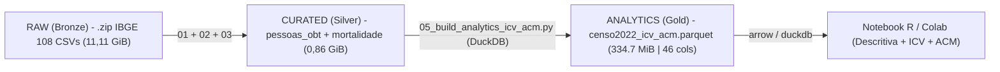

# Modelagem da Camada Analytics (Gold) — ICV + ACM (Censo Demográfico 2022)

> **Problema de pesquisa:** *"Quais características demográficas e domiciliares estão associadas às diferentes condições de vida da população brasileira?"*  
> **Créditos:** Pipeline e documentação elaborados com auxílio do **Google Antigravity**.  
> **Artefato gerado:** `data/analytics/censo2022_icv_acm.parquet` (**334.7 MiB**, Parquet ZSTD, arquivo único).  
> **Script produtor:** [`src/05_build_analytics_icv_acm.py`](../src/05_build_analytics_icv_acm.py) | **Telemetria/Auditoria:** [`metadata/analytics_icv_acm_report.json`](../metadata/analytics_icv_acm_report.json).

---

## 1. Visão Geral e Arquitetura (`raw` → `curated` → `analytics`)

A arquitetura do projeto segue o padrão em **3 camadas imutáveis**, garantindo rastreabilidade até os arquivos oficiais do IBGE sem alterar a camada curada:



### Fronteira de Responsabilidades (Pipeline vs. Notebook)
* **No pipeline (`05_build_analytics_icv_acm.py`):** filtro de escopo populacional, seleção enxuta de colunas, renomeação semântica padronizada (`<prefixo>_<nome>`), unificações estruturais determinísticas sem perda de informação (`F0210 + F0220`, `P0930 + P0950` e `NULL` estrutural de `P0260`), agregação e categorização de mortalidade por domicílio e validação de integridade.
* **No notebook (R / Google Colab):** recategorizações analíticas para a ACM (ex.: agrupamento de faixas etárias, arranjos familiares, faixas de renda), tratamento/fusão de categorias raras (< 1%), definição de pesos/escores e construção do Índice de Condição de Vida (ICV).

### Resumo Quantitativo e Sanity Checks Validados
| Métrica | Valor Validado |
| :--- | ---: |
| Linhas `pessoas_obt` (camada `curated` total) | 21,539,579 |
| Linhas excluídas pelo filtro de escopo (coletivos + improvisados) | 102,318 (0.48%) |
| **Linhas `censo2022_icv_acm.parquet` (antes == depois do JOIN mortalidade)** | **21,437,261** (`match=True`) |
| Unicidade da chave primária `(geo_uf, id_domicilio, id_morador)` | `True` |
| População expandida (`SUM(peso_pessoa)`) | **202,112,874** |
| Domicílios únicos na amostra / expandidos (`SUM(peso_domicilio)`) | 7,603,502 / **72,469,121** |
| Famílias únicas na amostra / expandidas (`SUM(peso_familia)`) | 6,550,293 / **62,037,364** |
| Total de colunas | **46 colunas** |
| Tamanho do arquivo único (Parquet ZSTD) | **334.7 MiB** |
| Tempo total de construção + auditorias | 50.1 s |

---

## 2. Justificativa do Filtro de Escopo (Linhas)

### 2.1 Por que manter apenas `p0130 = '01 - Domicílio particular permanente ocupado'`?
* Os **domicílios coletivos com morador** (`06`, 83,458 registros na amostra) — como presídios, asilos, quartéis, hotéis e alojamentos — **não possuem questionário de características domiciliares** (esgoto, água, paredes, rendimento domiciliar per capita, condição de ocupação, família), gerando ~100% de `NULL` estrutural nos blocos `dom_` e `cv_`.
* Os **domicílios particulares improvisados ocupados** (`05`, 18,860 registros na amostra, ~0,07% da população) — como barracas, veículos e imóveis não residenciais — também possuem preenchimento parcial no questionário domiciliar e constituem categoria extremamente rara na ACM.
* Restringir o escopo aos **domicílios particulares permanentes ocupados** (99.52% dos registros; 202,112,874 habitantes) segue o padrão metodológico do IBGE para indicadores de condições de vida e habitação, eliminando `NULL`s estruturais artificiais.

### 2.2 Por que manter **todas as idades** (sem filtrar 18+ ou responsáveis)?
* O problema de pesquisa investiga as condições de vida da **população brasileira** como um todo — crianças e idosos são grupos centrais na avaliação de vulnerabilidade habitacional, saneamento, adensamento e renda per capita.
* Variáveis específicas de faixas etárias (como `cv_condicao_trabalho_14mais`, aplicável a 14+ anos, ou `cv_alfabetizacao`, 5+ anos) preservam `NULL` nativo fora da faixa elegível, permitindo ao notebook decidir livremente sub-recortes (ex.: `dem_idade_anos >= 18` ou `dem_flag_responsavel = TRUE`) sem precisar reconstruir o pipeline.

---

## 3. Justificativa da Seleção e Exclusão de Colunas

Das **172 colunas** da tabela curada `pessoas_obt`, foram utilizadas **41 colunas de origem** (36 mapeadas 1:1 + `F0210`/`F0220` unificadas em `dom_arranjo_familiar` + `P0930`/`P0950` unificadas em `cv_condicao_trabalho_14mais` + `P0130` aplicada no filtro de escopo, além da flag derivada `dem_flag_responsavel`), somadas às **7 colunas agregadas/categorizadas de `mortalidade.parquet`**, totalizando **46 colunas** organizadas em 7 prefixos semânticos (`id_`, `peso_`, `geo_`, `dem_`, `dom_`, `cv_`, `mort_`).

### Tratamentos estruturais determinísticos (sem perda de informação)
1. **`dom_arranjo_familiar` (`F0210 + F0220`):** no layout oficial do IBGE, a tipologia familiar é dividida em duas colunas **100% mutuamente exclusivas** (0 registros com ambas preenchidas): `F0210` (famílias únicas e conviventes principais — 88,4% da população) e `F0220` (famílias conviventes secundárias — 4,4% da população). Unificá-las com o prefixo `"Convivente secundária - "` para `F0220` evita perda de informação e elimina `NULL`s artificiais. Os `NULL`s remanescentes (~6,9%) correspondem estruturalmente a domicílios unipessoais (`dom_num_moradores = 1`, ~6,7%) e domicílios sem laço familiar (~0,5%).
2. **`cv_condicao_trabalho_14mais` (`P0930 + P0950`):** nos microdados, `P0950` (ocupação) só é preenchida para quem está na força de trabalho (`P0930 = 1`), deixando 55,9% de `NULL` quando mantida separada (misturando crianças `< 14` com adultos fora da força). A unificação hierárquica em `'1 - Ocupada'`, `'2 - Desocupada'` e `'3 - Fora da força de trabalho'` preserva 100% da informação, elimina redundância na ACM e restringe o `NULL` estritamente a menores de 14 anos (19,11%).
3. **`dem_quilombola` (`P0260`):** no Censo 2022, o quesito quilombola só foi aplicado em setores com localidades quilombolas mapeadas, resultando em 90,3% de `NULL` estrutural. O preenchimento determinístico com `'2 - Não (fora de localidade quilombola)'` zera os `NULL`s e evita distorções em tabelas descritivas e na ACM.
4. **`cv_maquina_lavar` (`D0320`):** incluída por ser o único bem durável domiciliar disponível no Censo 2022 além da internet (`cv_internet`), com 0% de `NULL` e excelente equilíbrio de classes (~62% Sim / ~38% Não) para o ICV e a ACM.

### Colunas descartadas da `pessoas_obt` (131 colunas agrupadas por critério)

### 1. Geografia fina, chaves auxiliares e metadados de coleta (12 colunas)
Recortes subestaduais de alta cardinalidade (até 5.570 municípios) ou metadados operacionais da entrevista (informante, forma de declaração de idade) sem função direta no ICV/ACM nacional.

* **Códigos IBGE descartados:** `P0030`, `P0040`, `P0050`, `P0060`, `P0070`, `P0080`, `P0090`, `P0120`, `P0200`, `P1210`, `P1220`, `F0150`

### 2. Redundância e colinearidade com variáveis selecionadas (43 colunas)
Informação já capturada de forma mais sintética, limpa ou menos colinear pelas colunas escolhidas (ex.: P0150 sexo público vs. P0160; P0420–P0460 deficiências específicas vs. indicador P0470; D0340 ocorrência de óbito vs. bloco agregado mort_*; D0290/D0280 vs. D0260/D0270; atributos do responsável/família já deriváveis de PESS+DOMI).

* **Códigos IBGE descartados:** `P0150`, `P0190`, `P0290`, `P0420`, `P0430`, `P0440`, `P0450`, `P0460`, `P0760`, `P0910`, `P0920`, `P0960`, `P1070`, `P1080`, `P1090`, `P1100`, `P1110`, `D0170`, `D0171`, `D0180`, `D0181`, `D0220`, `D0230`, `D0280`, `D0290`, `D0340`, `D0350`, `D0370`, `D0380`, `D0390`, `D0400`, `D0410`, `F0160`, `F0170`, `F0180`, `F0181`, `F0190`, `F0200`, `F0230`, `F0240`, `F0250`, `F0260`, `F0270`

### 3. Alta cardinalidade e/ou NA estrutural (subpopulações específicas) (60 colunas)
Quesitos condicionais aplicáveis apenas a frações específicas (migrantes, estudantes atuais, ocupados, indígenas, graduados) ou com dezenas/centenas de categorias (município de destino, CBO, CNAE, curso superior), incompatíveis com a estabilidade fatorial da ACM.

* **Códigos IBGE descartados:** `P0230`, `P0240`, `P0250`, `P0490`, `P0500`, `P0510`, `P0520`, `P0530`, `P0540`, `P0550`, `P0560`, `P0570`, `P0580`, `P0590`, `P0600`, `P0610`, `P0620`, `P0630`, `P0650`, `P0660`, `P0670`, `P0680`, `P0690`, `P0700`, `P0710`, `P0720`, `P0730`, `P0740`, `P0750`, `P0780`, `P0800`, `P0810`, `P0820`, `P0830`, `P0840`, `P0850`, `P0860`, `P0870`, `P0880`, `P0890`, `P0900`, `P0940`, `P0970`, `P0980`, `P0990`, `P1000`, `P1010`, `P1020`, `P1030`, `P1040`, `P1050`, `P1060`, `P1120`, `P1130`, `P1140`, `P1150`, `P1160`, `P1170`, `P1180`, `P1190`

### 4. Fora do escopo temático da pesquisa (ICV + condições de vida) (16 colunas)
Temas específicos não centrais ao recorte de condições de vida e habitação (fecundidade detalhada P0320–P0400, religião P0410–P0411, registro civil infantil P0270, coabitação com pais P0300–P0310, diagnóstico de autismo P1200).

* **Códigos IBGE descartados:** `P0270`, `P0300`, `P0310`, `P0320`, `P0330`, `P0340`, `P0350`, `P0360`, `P0370`, `P0380`, `P0381`, `P0390`, `P0400`, `P0410`, `P0411`, `P1200`


---

## 4. Dicionário de Dados da Tabela Analytics (`46` colunas)

| # | Coluna Analytics | Bloco | Origem (`curated`) | Código IBGE | Tipo | % `NULL` | Cardinalidade | Justificativa de Inclusão |
| :---: | :--- | :---: | :--- | :---: | :---: | ---: | ---: | :--- |
| 1 | `id_domicilio` | `id_` | `p0100_controle_domicilio` | `P0100` | `VARCHAR` | 0.00% | 7,603,502 | Chave de identificação do domicílio dentro da UF; essencial para deduplicação em análises domiciliares e checagem de integridade. |
| 2 | `id_morador` | `id_` | `p0101_ordem_morador` | `P0101` | `VARCHAR` | 0.00% | 36 | Ordem do morador no domicílio; compõe a chave primária única (geo_uf, id_domicilio, id_morador). |
| 3 | `id_familia` | `id_` | `p0115_ordem_familia` | `P0115` | `VARCHAR` | 6.91% | 10 | Ordem da família no domicílio; permite deduplicação no grão família (NULL em domicílios unipessoais ou sem parentesco). |
| 4 | `peso_pessoa` | `peso_` | `p0111_peso_amostral_pessoa` | `P0111` | `DOUBLE` | 0.00% | 5,451,110 | Peso amostral obrigatório para inferência populacional no grão pessoa (Nota Metodológica NM 04/2026). |
| 5 | `peso_domicilio` | `peso_` | `d0111_peso_amostral_domicilio` | `D0111` | `DOUBLE` | 0.00% | 5,451,110 | Peso amostral obrigatório para inferência no grão domicílio (após deduplicação por geo_uf + id_domicilio). |
| 6 | `peso_familia` | `peso_` | `f0111_peso_amostral_familia` | `F0111` | `DOUBLE` | 6.91% | 4,879,472 | Peso amostral obrigatório para inferência no grão família (após deduplicação por geo_uf + id_domicilio + id_familia). |
| 7 | `geo_regiao` | `geo_` | `p0010_grande_regiao` | `P0010` | `VARCHAR` | 0.00% | 5 | Macrorregião geográfica (5 categorias); captura desigualdades estruturais regionais do Brasil na descritiva e na ACM. |
| 8 | `geo_uf` | `geo_` | `p0020_uf` | `P0020` | `VARCHAR` | 0.00% | 27 | Unidade da Federação (27 categorias); compõe a chave primária e permite estratificação estadual. |
| 9 | `dem_sexo` | `dem_` | `p0160_sexo` | `P0160` | `VARCHAR` | 0.00% | 2 | Sexo biológico/declarado (sem imputação pública de P0150); eixo demográfico básico de estratificação. |
| 10 | `dem_faixa_etaria` | `dem_` | `p0180_idade_faixa` | `P0180` | `VARCHAR` | 0.00% | 18 | Faixas etárias oficiais do IBGE (18 categorias) como ponto de partida para recategorização etária no notebook. |
| 11 | `dem_idade_anos` | `dem_` | `p0181_idade_anos` | `P0181` | `BIGINT` | 0.00% | 129 | Idade exata em anos; permite construir faixas customizadas (ex.: ciclos de vida, 14+, 18+, 60+) no notebook sem perda de precisão. |
| 12 | `dem_cor_raca` | `dem_` | `p0210_cor_raca_pessoa` | `P0210` | `VARCHAR` | 0.00% | 6 | Autodeclaração de cor ou raça; marcador central de desigualdade socioeconômica e de condições de vida no Brasil. |
| 13 | `dem_indigena` | `dem_` | `p0220_pessoa_indigena` | `P0220` | `VARCHAR` | 0.00% | 2 | Identificação complementar de população indígena (incluindo quem se declara indígena por quesito específico além de cor/raça). |
| 14 | `dem_quilombola` | `dem_` | `COALESCE(p0260_pessoa_quilombola, '2 - Não (fora de localidade quilombola)')` | `P0260` | `VARCHAR` | 0.00% | 3 | Identificação de população quilombola (novidade do Censo 2022); NULL estrutural (90,3%, setores sem localidade quilombola mapeada) preenchido explicitamente para evitar falsos ausentes. |
| 15 | `dem_estado_conjugal` | `dem_` | `p0280_convivencia_conjuge_companheiro_pessoa` | `P0280` | `VARCHAR` | 13.54% | 3 | Convivência com cônjuge ou companheiro(a); associa-se à composição de renda e suporte intradomiciliar. |
| 16 | `dem_migracao_nascimento` | `dem_` | `p0480_local_nascimento_pessoa` | `P0480` | `VARCHAR` | 0.00% | 3 | Indicador sintético de naturalidade/migração (mesmo município, outro município, outro país) com baixa cardinalidade (4 cats.). |
| 17 | `dem_deficiencia` | `dem_` | `p0470_variavel_indicadora_existencia_deficiencia` | `P0470` | `VARCHAR` | 0.00% | 3 | Indicador consolidado de deficiência (evita redundância das 5 perguntas desagregadas P0420–P0460). |
| 18 | `dem_condicao_domicilio` | `dem_` | `p0170_condicao_domicilio_pessoa` | `P0170` | `VARCHAR` | 0.00% | 19 | Relação de parentesco/condição no domicílio (responsável, cônjuge, filho, etc.); permite análises de chefia e dependência. |
| 19 | `dem_flag_responsavel` | `dem_` | `Derivada de p0170_condicao_domicilio_pessoa` | `P0170*` | `BOOLEAN` | 0.00% | 2 | Flag determinística (TRUE quando P0170 = '01 - Pessoa responsável pelo domicílio') para facilitar recortes no nível de responsáveis/domicílios. |
| 20 | `dom_situacao_urbano_rural` | `dom_` | `p0140_situacao_domicilio` | `P0140` | `VARCHAR` | 0.00% | 2 | Situação urbana vs. rural; determinante estrutural do acesso a infraestrutura, saneamento e conectividade. |
| 21 | `dom_tipo` | `dom_` | `d0200_tipo_especie` | `D0200` | `VARCHAR` | 0.00% | 6 | Tipo do domicílio (casa, apartamento, cômodo, habitação em cortiço, etc.); reflete padrão construtivo e precariedade habitacional. |
| 22 | `dom_condicao_ocupacao` | `dom_` | `d0190_condicao_ocupacao_domicilio` | `D0190` | `VARCHAR` | 0.00% | 7 | Condição de posse/ocupação (próprio quitado, financiado, alugado, cedido); indicador de segurança habitacional. |
| 23 | `dom_num_moradores` | `dom_` | `d0150_moradores_domicilio` | `D0150` | `BIGINT` | 0.00% | 34 | Total de moradores no domicílio; permite identificar domicílios unipessoais (d0150 = 1) e tamanho domiciliar. |
| 24 | `dom_arranjo_familiar` | `dom_` | `COALESCE(f0210, 'Convivente secundária - ' || f0220)` | `F0210+F0220` | `VARCHAR` | 6.91% | 15 | Tipologia do arranjo familiar unificando famílias únicas/principais (F0210) e conviventes secundárias (F0220, 0% de sobreposição) com prefixo sem perda de informação. |
| 25 | `dom_num_criancas` | `dom_` | `d0160_criancas_domicilio` | `D0160` | `BIGINT` | 0.00% | 15 | Número de crianças no domicílio; proxy direta de razão de dependência infantil e pressão sobre renda domiciliar. |
| 26 | `dom_material_paredes` | `dom_` | `d0210_material_paredes_domicilio` | `D0210` | `VARCHAR` | 0.00% | 7 | Material predominante das paredes externas; indicador físico clássico de adequação/precariedade da moradia. |
| 27 | `cv_renda_per_capita` | `cv_` | `d0360_rendimento_domiciliar_per_capita` | `D0360` | `DOUBLE` | 0.00% | 55,250 | Rendimento domiciliar per capita (em R$); principal dimensão monetária do ICV e referência para faixas de renda no notebook. |
| 28 | `cv_condicao_trabalho_14mais` | `cv_` | `Unificação hierárquica de p0930 + p0950` | `P0930+P0950` | `VARCHAR` | 19.11% | 3 | Condição de trabalho para 14+ anos ('1 - Ocupada', '2 - Desocupada', '3 - Fora da força de trabalho'; NULL apenas para < 14 anos), eliminando 55,9% de NULL e colinearidade sem perda de informação. |
| 29 | `cv_escolaridade` | `cv_` | `p0770_morador_nivel_instrucao_ensino_compativel_censo_demografico` | `P0770` | `VARCHAR` | 0.00% | 4 | Nível de instrução harmonizado (5 categorias); ideal para ACM e comparabilidade histórica sem fragmentação excessiva. |
| 30 | `cv_anos_estudo` | `cv_` | `p0790_anos_estudo_pessoa` | `P0790` | `BIGINT` | 0.08% | 17 | Anos completos de estudo (numérico); insumo contínuo de capital humano para o ICV e estatísticas descritivas. |
| 31 | `cv_alfabetizacao` | `cv_` | `p0640_alfabetizacao_pessoa` | `P0640` | `VARCHAR` | 6.56% | 2 | Condição de alfabetização (5+ anos); indicador básico de privação educacional. |
| 32 | `cv_agua_abastecimento` | `cv_` | `d0260_abastecimento_agua_domicilio` | `D0260` | `VARCHAR` | 0.00% | 8 | Forma principal de abastecimento de água; componente essencial da dimensão saneamento do ICV. |
| 33 | `cv_agua_canalizada` | `cv_` | `d0300_existencia_agua_canalizada_domicilio` | `D0300` | `VARCHAR` | 0.00% | 3 | Existência de água canalizada no domicílio/terreno; complementa a fonte de água com a qualidade do acesso intradomiciliar. |
| 34 | `cv_esgoto` | `cv_` | `d0250_tipo_esgotamento_sanitario_domicilio` | `D0250` | `VARCHAR` | 0.00% | 8 | Tipo de esgotamento sanitário; marcador crítico de saneamento básico e saúde ambiental. |
| 35 | `cv_lixo` | `cv_` | `d0310_destino_lixo_domicilio` | `D0310` | `VARCHAR` | 0.00% | 6 | Destino do lixo domiciliar; completa o tripé clássico de saneamento básico (água, esgoto, coleta de lixo). |
| 36 | `cv_internet` | `cv_` | `d0330_acesso_internet_existencia` | `D0330` | `VARCHAR` | 0.00% | 2 | Existência de acesso à internet no domicílio; indicador contemporâneo de inclusão digital e condições de vida. |
| 37 | `cv_maquina_lavar` | `cv_` | `d0320_existencia_maquina_lavar_roupa_domicilio` | `D0320` | `VARCHAR` | 0.00% | 2 | Existência de máquina de lavar roupa no domicílio (0% NULL, 62%/38%); único bem durável domiciliar além da internet no Censo 2022, forte discriminador para ICV e ACM. |
| 38 | `cv_adensamento` | `cv_` | `d0240_numero_moradores_comodo_utilizado_como_dormitorio` | `D0240` | `DOUBLE` | 0.00% | 133 | Razão moradores por dormitório; indicador padrão de adensamento excessivo habitacional (ex.: > 3 moradores/dormitório). |
| 39 | `cv_banheiro_exclusivo` | `cv_` | `d0270_existencia_banheiro_sanitario_numero_banheiros_uso_exclusivo` | `D0270` | `VARCHAR` | 0.00% | 7 | Existência de banheiro de uso exclusivo e quantidade; captura privação sanitária severa e padrão habitacional. |
| 40 | `mort_qtd_obitos` | `mort_` | `Agregação de mortalidade.parquet (COUNT)` | `MORT*` | `BIGINT` | 0.00% | 8 | Total de óbitos de moradores ocorridos no domicílio entre jan/2019 e jul/2022 (0 se sem óbito). |
| 41 | `mort_idade_min_obito` | `mort_` | `Agregação de m0171_idade_falecido_anos (MIN)` | `M0171*` | `BIGINT` | 94.96% | 127 | Menor idade entre os falecidos do domicílio (NULL se sem óbito ou idade ignorada); permite testar limiares alternativos no notebook. |
| 42 | `mort_qtd_obitos_prematuros` | `mort_` | `Agregação de m0171_idade_falecido_anos (< 60)` | `M0171*` | `BIGINT` | 0.00% | 5 | Quantidade de óbitos prematuros (< 60 anos) no domicílio (0 se sem óbito). |
| 43 | `mort_qtd_obitos_pandemia` | `mort_` | `Agregação de m0150_ano_obito (2020–2021)` | `M0150*` | `BIGINT` | 0.00% | 7 | Quantidade de óbitos ocorridos nos anos de pico pandêmico de COVID-19 (2020 e 2021) no domicílio (0 se sem óbito). |
| 44 | `mort_ocorrencia_cat` | `mort_` | `Derivada de mort_qtd_obitos` | `MORT*` | `VARCHAR` | 0.00% | 3 | Categórica pronta para descritiva/ACM: 'Sem óbito', '1 óbito', '2 ou mais óbitos'. |
| 45 | `mort_perfil_etario_cat` | `mort_` | `Derivada de m0171_idade_falecido_anos` | `M0171*` | `VARCHAR` | 0.00% | 4 | Perfil etário dos óbitos no domicílio: 'Sem óbito', 'Apenas idoso (60+)', 'Óbito prematuro (< 60 anos)' ou fallback 'Óbito com idade ignorada'. |
| 46 | `mort_periodo_cat` | `mort_` | `Derivada de m0150_ano_obito` | `M0150*` | `VARCHAR` | 0.00% | 4 | Período dos óbitos no domicílio: 'Sem óbito', 'Apenas fora do pico pandêmico (2019/2022)', 'Inclui período pandêmico (2020–2021)' ou fallback 'Óbito com ano ignorado'. |

---

## 5. Justificativa Metodológica da Agregação e Categorização de Mortalidade (`mort_`)

### 5.1 Por que agregar `mortalidade.parquet` por domicílio ANTES do `LEFT JOIN`?
Na camada curada, `mortalidade.parquet` tem grão **1 linha = 1 óbito** (430.965 óbitos em 412.427 domicílios; 17.551 domicílios registraram 2 ou mais óbitos). Um `LEFT JOIN` direto com `pessoas_obt` multiplicaria as linhas dos moradores desses domicílios (**produto cartesiano**), inflando a população expandida e distorcendo pesos amostrais.

A agregação prévia em CTE por `(SUBSTRING(m0020_uf, 1, 2), m0100_controle_domicilio)` garante relação **N:1 estrita** (`pessoas_obt` → `mort_dom`), verificada automaticamente pelo `assert` de igualdade de linhas antes e depois do join (`21,437,261 == 21,437,261`).

### 5.2 Regras de Construção, Fallbacks e Cuidados para a ACM
* **Domicílios sem óbito:** preenchidos explicitamente com `0` nas contagens numéricas e `'Sem óbito'` nas categóricas (0% de `NULL` nas 3 categóricas `mort_*`). Apenas `mort_idade_min_obito` permanece `NULL` quando não houve óbito (ou quando a idade do falecido foi ignorada), pois `0` significaria óbito de menor de 1 ano.
* **Regra de precedência e fallbacks auditados nos dados reais:**
  * `mort_perfil_etario_cat`: se houve ao menos 1 óbito com `m0171_idade_falecido_anos < 60`, classifica-se como `'Óbito prematuro (< 60 anos)'`; senão, se houve óbito com idade `>= 60`, classifica-se como `'Apenas idoso (60+)'`; se todos os óbitos do domicílio tiveram idade `NULL`, recebe o fallback explícito `'Óbito com idade ignorada'`.
  * `mort_periodo_cat`: se houve ao menos 1 óbito em `'2 - 2020'` ou `'3 - 2021'` (pico da pandemia de COVID-19), classifica-se como `'Inclui período pandêmico (2020–2021)'`; senão, se houve óbito em `'1 - 2019'` ou `'4 - 2022'`, classifica-se como `'Apenas fora do pico pandêmico (2019/2022)'`; se todos os óbitos tiveram `'9 - Ignorado'`, recebe o fallback `'Óbito com ano ignorado'`.
* **Orientação importante para a ACM (no notebook):**
  1. **Evitar colinearidade do bloco `"Sem óbito"`:** como ~95% dos domicílios pertencem à categoria `'Sem óbito'`, **não inclua as 3 categóricas `mort_*` simultaneamente como variáveis ativas** na ACM. Escolha **uma** variável temática por modelo (ex.: `mort_perfil_etario_cat`) ou projete as demais como **variáveis suplementares (`quali.sup`)** e as contagens numéricas como `quanti.sup`.
  2. **Categorias raras de fallback:** `'Óbito com idade ignorada'` e `'Óbito com ano ignorado'` representam `< 0,02%` da base; no notebook, filtre-as ou agrupe-as na etapa de tratamento de categorias raras antes de ajustar a ACM.
  3. **Limitação amostral do período:** o Censo 2022 registrou óbitos ocorridos entre **janeiro/2019 e julho/2022** (3,5 anos) **apenas em domicílios que continuaram existindo** na data de referência (óbitos em domicílios unipessoais que se extinguiram não são captados pela pesquisa).

### 5.3 Distribuições Ponderadas Validadas (`mort_*`)

#### Ocorrência de óbitos no domicílio (`mort_ocorrencia_cat`)
| Categoria | Domicílios (Amostra) | Domicílios Expandidos | % Domicílios | Pessoas Expandidas | % Pessoas |
| :--- | ---: | ---: | ---: | ---: | ---: |
| `Sem óbito` | 7,191,343 | 68,621,884 | 94.69% | 192,025,188 | 95.01% |
| `1 óbito` | 394,621 | 3,679,458 | 5.08% | 9,634,533 | 4.77% |
| `2 ou mais óbitos` | 17,538 | 167,779 | 0.23% | 453,153 | 0.22% |

#### Perfil etário dos óbitos no domicílio (`mort_perfil_etario_cat`)
| Categoria | Domicílios (Amostra) | Domicílios Expandidos | % Domicílios | Pessoas Expandidas | % Pessoas |
| :--- | ---: | ---: | ---: | ---: | ---: |
| `Sem óbito` | 7,191,343 | 68,621,884 | 94.69% | 192,025,188 | 95.01% |
| `Apenas idoso (60+)` | 277,304 | 2,603,384 | 3.59% | 6,475,561 | 3.20% |
| `Óbito prematuro (< 60 anos)` | 134,052 | 1,237,180 | 1.71% | 3,595,286 | 1.78% |
| `Óbito com idade ignorada` | 803 | 6,673 | 0.01% | 16,839 | 0.01% |

#### Período dos óbitos no domicílio (`mort_periodo_cat`)
| Categoria | Domicílios (Amostra) | Domicílios Expandidos | % Domicílios | Pessoas Expandidas | % Pessoas |
| :--- | ---: | ---: | ---: | ---: | ---: |
| `Sem óbito` | 7,191,343 | 68,621,884 | 94.69% | 192,025,188 | 95.01% |
| `Inclui período pandêmico (2020–2021)` | 239,098 | 2,252,029 | 3.11% | 5,910,205 | 2.92% |
| `Apenas fora do pico pandêmico (2019/2022)` | 173,058 | 1,595,160 | 2.20% | 4,177,406 | 2.07% |
| `Óbito com ano ignorado` | 3 | 47 | 0.00% | 74 | 0.00% |

---

## 6. Exemplo de Leitura Rápida em R (Colab) com `duckdb` / `arrow`

```r
library(duckdb)
library(DBI)

con <- dbConnect(duckdb::duckdb())

# Exemplo 1: Distribuição ponderada de mortalidade por Grande Região (grão pessoa)
res_pessoas <- dbGetQuery(con, "
  SELECT
    geo_regiao,
    mort_perfil_etario_cat,
    ROUND(SUM(peso_pessoa), 0) AS pop_estimada,
    ROUND(100.0 * SUM(peso_pessoa) / SUM(SUM(peso_pessoa)) OVER (PARTITION BY geo_regiao), 2) AS pct_regiao
  FROM read_parquet('data/analytics/censo2022_icv_acm.parquet')
  GROUP BY geo_regiao, mort_perfil_etario_cat
  ORDER BY geo_regiao, pop_estimada DESC
")

# Exemplo 2: Métrica no grão DOMICÍLIO (sempre deduplicar por geo_uf + id_domicilio)
res_domicilios <- dbGetQuery(con, "
  WITH dom AS (
    SELECT
      geo_uf,
      id_domicilio,
      ANY_VALUE(peso_domicilio) AS peso_dom,
      ANY_VALUE(cv_esgoto) AS esgoto,
      ANY_VALUE(mort_ocorrencia_cat) AS mort_cat
    FROM read_parquet('data/analytics/censo2022_icv_acm.parquet')
    GROUP BY geo_uf, id_domicilio
  )
  SELECT
    mort_cat,
    ROUND(SUM(peso_dom), 0) AS domicilios_estimados
  FROM dom
  GROUP BY mort_cat
  ORDER BY domicilios_estimados DESC
")
```
